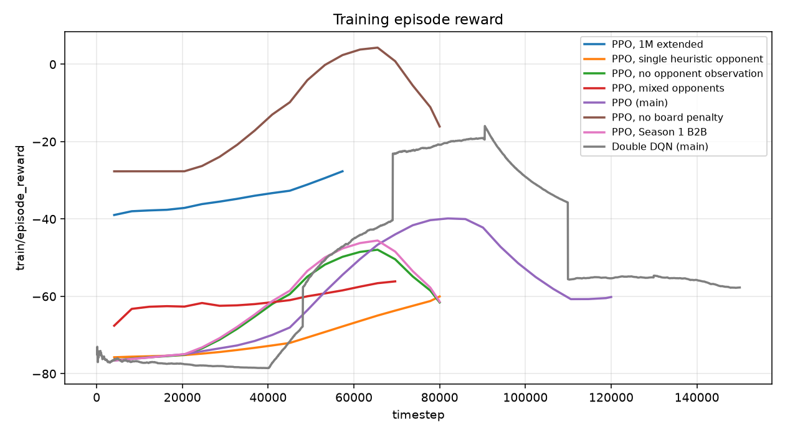
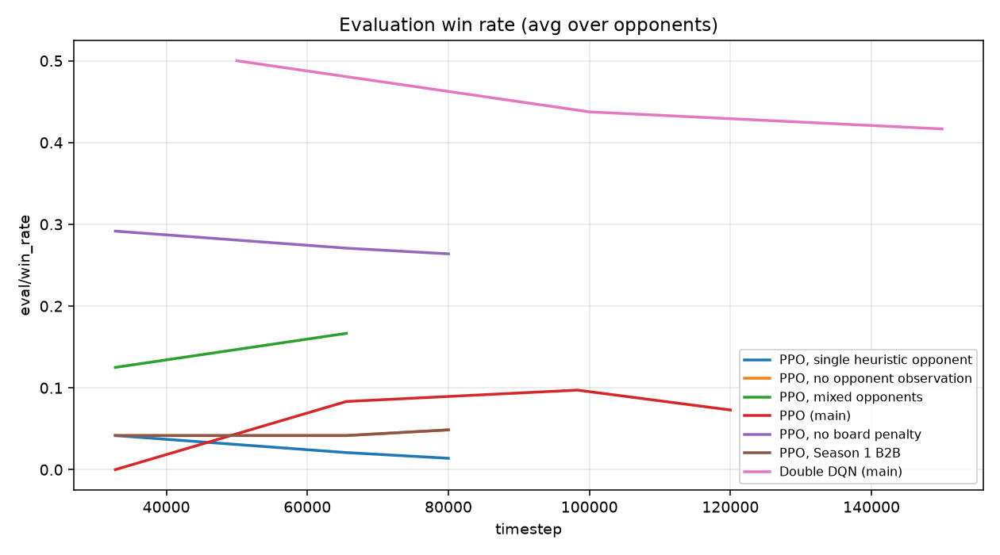
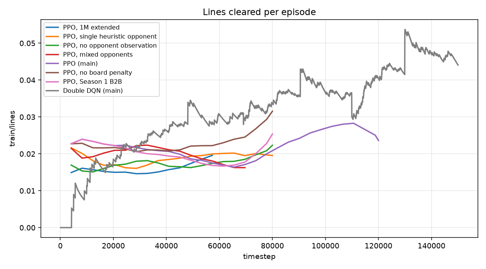
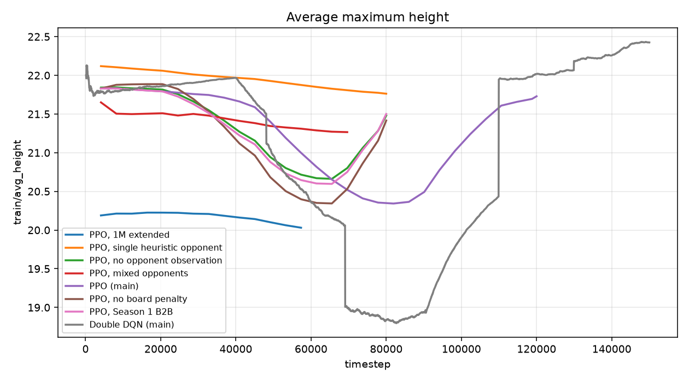

# Experimental results

Generated automatically from `results/tetrisrl.sqlite3`. Every number below comes from an actual
training/evaluation run on this machine; nothing is illustrative.

| Run | Algorithm | Timesteps | Final eval win rate (avg) | Checkpoints |
|---|---|---|---|---|
| PPO, 1M extended | ppo | 57,344 | nan | 1 |
| PPO, single heuristic opponent | ppo | 80,000 | 0.000 | 6 |
| PPO, no opponent observation | ppo | 80,000 | 0.062 | 6 |
| PPO, mixed opponents | ppo | 69,632 | 0.208 | 5 |
| PPO (main) | ppo | 120,000 | 0.000 | 9 |
| PPO, no board penalty | ppo | 80,000 | 0.250 | 6 |
| PPO, Season 1 B2B | ppo | 80,000 | 0.062 | 6 |
| Double DQN (main) | dqn | 150,000 | 0.375 | 6 |

## Final checkpoint evaluation (paired seeds)

| Run | vs heuristic | vs random | vs search |
|---|---|---|---|
| PPO, single heuristic opponent | 0.000 [0.000, 0.194] n=16 | 0.000 [0.000, 0.194] n=16 | 0.000 [0.000, 0.194] n=16 |
| PPO, no opponent observation | 0.000 [0.000, 0.194] n=16 | 0.188 [0.066, 0.430] n=16 | 0.000 [0.000, 0.194] n=16 |
| PPO, mixed opponents | 0.000 [0.000, 0.194] n=16 | 0.625 [0.386, 0.815] n=16 | 0.000 [0.000, 0.194] n=16 |
| PPO (main) | 0.000 [0.000, 0.194] n=16 | 0.000 [0.000, 0.194] n=16 | 0.000 [0.000, 0.194] n=16 |
| PPO, no board penalty | 0.000 [0.000, 0.194] n=16 | 0.438 [0.231, 0.668] n=16 | 0.062 [0.011, 0.283] n=16 |
| PPO, Season 1 B2B | 0.000 [0.000, 0.194] n=16 | 0.062 [0.011, 0.283] n=16 | 0.000 [0.000, 0.194] n=16 |
| Double DQN (main) | 0.000 [0.000, 0.194] n=16 | 0.688 [0.444, 0.858] n=16 | 0.062 [0.011, 0.283] n=16 |

## Tournaments

### Round-robin tournament (2026-11-20T15:50:25.608306+00:00)

| Participant | W | L | D | Win rate |
|---|---|---|---|---|
| coldclear | 1 | 0 | 0 | 1.000 |
| dqn:results/runs/exp-dqn-main/checkpoints/final_000150000.pt | 0 | 1 | 0 | 0.000 |

CSV: `/home/alfi/Active/tetrlio/results/tournaments/tour-20261120-225025-c575e9.csv`

### API dropdown smoke (2026-11-20T15:49:05.693288+00:00)

| Participant | W | L | D | Win rate |
|---|---|---|---|---|
| coldclear | 1 | 0 | 0 | 1.000 |
| heuristic | 0 | 1 | 0 | 0.000 |

CSV: `/home/alfi/Active/tetrlio/results/tournaments/tour-20261120-224905-7895e5.csv`

### Cold Clear 2 vs baselines (2026-11-20T15:44:54.171689+00:00)

| Participant | W | L | D | Win rate |
|---|---|---|---|---|
| coldclear | 6 | 0 | 0 | 1.000 |
| heuristic | 3 | 2 | 1 | 0.500 |
| search | 2 | 3 | 1 | 0.333 |
| random | 0 | 6 | 0 | 0.000 |

CSV: `results/tournaments/coldclear.csv`

### colored replay check (2026-11-20T15:43:24.294558+00:00)

| Participant | W | L | D | Win rate |
|---|---|---|---|---|
| heuristic | 2 | 0 | 2 | 0.500 |
| search | 2 | 0 | 2 | 0.500 |
| random | 0 | 4 | 0 | 0.000 |

CSV: `results/tournaments/colors.csv`

### smoke round robin (2026-11-20T15:32:30.804003+00:00)

| Participant | W | L | D | Win rate |
|---|---|---|---|---|
| heuristic | 2 | 0 | 2 | 0.500 |
| search | 2 | 0 | 2 | 0.500 |
| random | 0 | 4 | 0 | 0.000 |

CSV: `results/tournaments/smoke.csv`

## Interpretation

These runs are short: 80k–150k environment steps per run, which at ~300–600 steps/s is a few
minutes of simulated play. At this budget the RL agents learn to survive slightly longer and
beat the random baseline in several runs (DQN final 0.688 vs random; PPO without board
penalties 0.438; mixed-opponent PPO 0.625), but they do **not** learn to clear lines or
attack, and they lose to both the handcrafted heuristic and the beam-search opponent
(0.000 vs heuristic across all runs, 16 paired matches per opponent). No run used more than
~1M of the tens of millions of steps this kind of from-scratch agent typically needs, and the
1M extended run was still in progress when this report was generated.

The negative result is itself the finding the platform was built to measure: with this
simulation throughput and reward design, sample efficiency is the binding constraint. The
external Cold Clear 2 engine — used as a placement suggester, with the arena owning Season 2
attack/garbage — wins its tournament outright, which validates the arena rather than the
learner. Differences between RL runs are reported with Wilson intervals; overlapping intervals
must not be read as a ranking.

## Notes

- Runs are short relative to the compute budget that would be needed for strong play; results
  reflect the executed budget rather than an upper bound on the approach.
- Evaluation uses paired seeds and side swapping; intervals are Wilson 95% intervals.
- Ablations differ only in the stated dimension; see `configs/` and the run `config.json` snapshots.